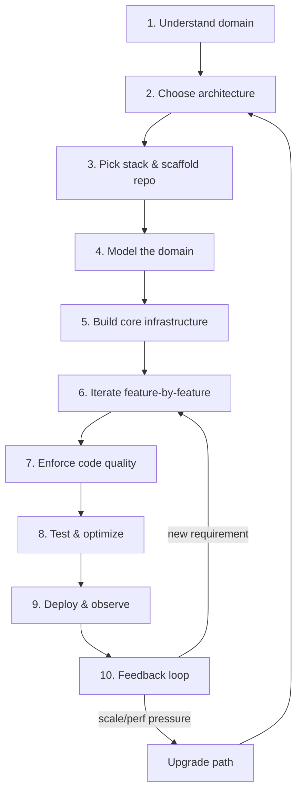

# Starting a .NET Project — Decision Guide

A condensed, decision-first playbook for kicking off a new .NET system and evolving it afterward.
Each phase links back to the week(s) in this repo where the underlying skill is practiced.

## Flow

---

## 1. Understand the business & domain
Clarify the **why** before writing code.
- Map core entities, actors, and workflows (e.g. for e-commerce: users → orders → payments → inventory).
- Identify constraints up front: expected load, uptime SLA, compliance/security needs, budget.
- Get real sample data or mockups — assumptions made here are the most expensive to undo later.
- Write down 3-5 non-functional requirements explicitly (latency target, RPS, data retention) — vague NFRs cause architecture rework later.

**Decision gate:** if you can't name the core entities and the one workflow that generates revenue/value, stop and clarify before step 2.

## 2. Choose the architecture
| Signal | Lean toward |
|---|---|
| Small team, one deploy unit, uncertain domain boundaries | Modular monolith |
| Independent scaling/deploy cadence per capability, multiple teams | Microservices |
| Read-heavy with complex queries vs. write-heavy with complex invariants | CQRS (separate read/write models) |
| Simple CRUD, few business rules | Traditional layered/CRUD |

- Default to **Clean Architecture** layering (Domain → Application → Infrastructure → Presentation) regardless of monolith vs. microservices — see [Week7-DesignPatterns/CleanArchitecture](../src/Week7-DesignPatterns/CleanArchitecture) and [week7.md](week7.md).
- Decide the data-flow style (CRUD, CQRS, event-driven) against the read/write shape identified in step 1, not by trend.
- Plan cross-cutting concerns *before* feature work starts: logging, auth, error handling, caching, configuration — see [Week5-AspNetCore](../src/Week5-AspNetCore) and [week5.md](week5.md).
- Don't reach for microservices/event sourcing/distributed consensus (see [week9.md](week9.md) / [week10.md](week10.md)) until a monolith has demonstrably hit a scaling or team-boundary limit — these add operational cost from day one.

## 3. Choose the stack & scaffold
- Pin exact versions (.NET, EF Core, DB, frontend framework) in the repo (`global.json`, `Directory.Build.props`) so builds are reproducible.
- Set up CI (build + test + lint) **before** the first feature PR — a red pipeline discovered on week 3 costs more than one configured on day one.
- Containerize early if the target is cloud/Kubernetes (`Dockerfile`, `docker-compose.yml` for local dependencies like Postgres/Redis).
- Commit an `.editorconfig` and analyzer ruleset (nullable enable, warnings-as-errors for new code) so style is enforced by tooling, not review comments.

**Goal:** get infrastructure boring and stable early so the team debates features, not tooling.

## 4. Model the domain
- Define entities and value objects first (`Order`, `Customer`, `Money`); shape repositories/services/controllers around them, not the other way around.
- Apply DDD tactically only where the domain has real invariants worth protecting (aggregate roots, value objects) — don't force it onto simple CRUD data.
- Define DTOs/contracts for API boundaries separately from domain entities — never let EF Core entities leak into HTTP responses. See [Week6-EFCore](../src/Week6-EFCore) and [week6.md](week6.md).
- Prefer `record` types for immutable value objects and DTOs — see [week1.md](week1.md).

## 5. Implement core infrastructure first
Before any business feature, the skeleton should be solid:
- DI container composition root, configuration binding (`IOptions<T>`), structured logging.
- Global exception-handling middleware — one place errors become consistent API responses.
- Base data-access layer: `DbContext`, migrations, unit-of-work if needed.
- AuthN/AuthZ scaffolding (JWT/OIDC, policies) wired in from the start, even if only one role exists initially.

## 6. Develop iteratively
- Slice by feature (UI → API → DB) rather than by layer, so each PR delivers an end-to-end, demoable increment.
- Use short-lived feature branches with PR review; keep `main` always deployable.
- Write tests alongside the code, not after — see [Week8-TestingAndPerformance](../src/Week8-TestingAndPerformance) and [week8.md](week8.md).
- Re-visit the architecture decision (step 2) only when a concrete pain point appears (e.g. one module needs independent scaling) — don't pre-emptively split.

## 7. Enforce code quality
- SOLID, DRY/KISS, dependency inversion — see [Week7-DesignPatterns](../src/Week7-DesignPatterns) and [week7.md](week7.md).
- Static analysis in CI (built-in analyzers, SonarQube/Roslynator) with a failing build on new violations, not just IDE warnings.
- Keep a consistent layered/modular structure — a decision recorded once (e.g. an ADR) beats re-litigating it per PR.

## 8. Test, validate, optimize
- Unit tests for logic, integration tests for the full pipeline (middleware, DI, routing), benchmarks for hot paths — see [week8.md](week8.md).
- Load/stress test before launch if traffic is uncertain (dedicated tool, not ad-hoc scripts — see [week8.md](week8.md)).
- Check GC pressure/allocations and async correctness under load — see [Week2-MemoryAndRuntime](../src/Week2-MemoryAndRuntime) / [Week3-AsyncAndConcurrency](../src/Week3-AsyncAndConcurrency).

## 9. Deploy & monitor
- Automate deployment (CI/CD); make rollback a tested, one-command operation, not a manual scramble.
- Add health checks (liveness vs. readiness), structured logs with correlation IDs, and tracing — see [Week9-SystemDesign/ObservabilityAndTracing](../src/Week9-SystemDesign/ObservabilityAndTracing) and [week9.md](week9.md).
- Gate risky changes behind feature flags instead of long-lived feature branches.

## 10. Feedback & continuous improvement
- Feed production metrics/user feedback back into the backlog — treat step 10 as looping back to step 6 (new features) or the upgrade path below (scale/perf/tech-debt driven changes).
- Track technical debt explicitly (a backlog label, not tribal memory) and schedule regular paydown, not just when it blocks a feature.

---

## Upgrade path — evolving an existing system

Use this when the trigger is **not** a new feature but a scale, risk, or platform-age pressure.

| Trigger | Typical response | Reference |
|---|---|---|
| Framework/runtime EOL approaching | Bump `TargetFramework`, re-run full test suite, check breaking-change notes before merging | this repo bumped net9→net10 repo-wide via a scripted `sed` + full solution rebuild — see `/memories/repo/dotnet-challenge-conventions.md` for the exact command |
| Single deploy unit can't scale a hot module independently | Extract that module into its own service behind a gateway; keep the rest of the monolith intact | [Week10-AdvancedSystemDesign/ApiGatewayAndServiceCommunication](../src/Week10-AdvancedSystemDesign/ApiGatewayAndServiceCommunication) |
| Read load outgrows a single DB | Add caching (`IDistributedCache`) first; only add read replicas/sharding if caching isn't enough | [Week9-SystemDesign/ScalabilityAndCaching](../src/Week9-SystemDesign/ScalabilityAndCaching), [Week10-AdvancedSystemDesign/DatabaseDesignAndReplication](../src/Week10-AdvancedSystemDesign/DatabaseDesignAndReplication) |
| Downstream dependency flakiness causing cascading failures | Add retry+backoff, circuit breaker, and bulkhead isolation (Polly) — don't just add more retries | [Week9-SystemDesign/ResilienceAndRateLimiting](../src/Week9-SystemDesign/ResilienceAndRateLimiting) |
| Growing write volume across services | Move from direct calls to async messaging/outbox pattern for eventual consistency | [Week9-SystemDesign/MessagingAndEventDrivenArchitecture](../src/Week9-SystemDesign/MessagingAndEventDrivenArchitecture) |
| Recurring production incidents with no visibility | Add/upgrade observability (structured logs + correlation IDs + tracing) before adding more infrastructure | [Week9-SystemDesign/ObservabilityAndTracing](../src/Week9-SystemDesign/ObservabilityAndTracing) |
| Security/compliance audit findings | Rotate to a secrets manager, enforce TLS termination points, add token validation at every hop | [Week10-AdvancedSystemDesign/SecurityAtScale](../src/Week10-AdvancedSystemDesign/SecurityAtScale) |
| Test suite too slow / flaky to trust before release | Separate unit (fast, isolated) from integration (full pipeline) suites; run unit tests on every push, integration on PR merge | [Week8-TestingAndPerformance](../src/Week8-TestingAndPerformance) |

### Upgrade discipline
1. **Measure before changing** — an upgrade driven by a metric (p99 latency, error rate, GC pause time) is defensible; one driven by "this feels old" is not.
2. **One structural change at a time** — don't combine a framework bump with an architecture change in the same release; isolate the risk.
3. **Always keep a rollback path** — DB migrations should be backward-compatible for at least one release (expand/contract pattern) so a rollback doesn't require a down-migration under pressure.
4. **Re-run the full test + benchmark suite** after any upgrade — a passing build isn't proof of behavioral or performance parity.
5. **Record the decision** — a short ADR (Architecture Decision Record: context, decision, consequences) costs minutes and saves re-debating the same trade-off in a year.
